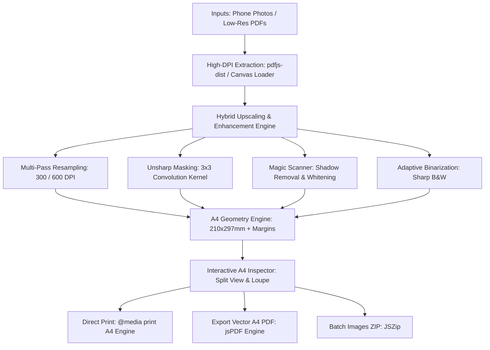

<div align="center">

# 🖨️ PrintStudio
### Ultra-Sharp 300/600 DPI Image & PDF Print Upscaler for Web & Android

[](https://github.com/nextsemacademy-max/PrintStudio/actions)
[](https://github.com/nextsemacademy-max/PrintStudio)
[](LICENSE)
[](https://vitejs.dev)
[](https://capacitorjs.com)
[-emerald?style=flat-square&logo=speedtest)](https://github.com/nextsemacademy-max/PrintStudio)

**Transform blurry phone photos, textbook scans, and low-res PDFs into razor-sharp, print-ready A4 documents with automatic shadow removal, paper whitening, and margin optimization.**

[Live Web Demo](#-getting-started) • [Key Features](#-core-capabilities) • [Android App](#-android-application) • [Architecture](#-architecture)

</div>

---

## 📌 The Problem This Solves

When students or professionals try to print lecture notes or documents taken with phone cameras:
1. **Low Print Resolution (72–96 DPI)**: Standard screen photos print pixelated, blurry, and hard to read.
2. **Muddy Background Shadows**: Uneven desk lighting and hand shadows waste toner ink and look dirty on physical paper.
3. **Mismatched Page Dimensions**: Documents print with clipped margins or awkward scaling.

**PrintStudio** solves all three with an in-browser WebGL & Canvas pipeline that runs **100% on-device** with zero server uploads.

---

## 🌟 Core Capabilities

| Feature | Description | Benefit |
| :--- | :--- | :--- |
| **300 & 600 DPI Upscaler** | High-fidelity canvas resampling + unsharp masking | Razor-sharp text, formulas, and fine lines on paper |
| **🪄 Magic Document Scan** | Adaptive background leveling & shadow elimination | Turns muddy yellow paper into clean pure white `#ffffff` |
| **⚡ Sharp B&W (Ink Saver)** | Adaptive binarization / Otsu thresholding | Eliminates toner fuzz; perfect for office laser printing |
| **📐 Precise A4 Layout** | Strict $210 \times 297\text{ mm}$ geometry with 0–15mm margins | Prevents clipped text and leaves binder filing space |
| **🔍 Interactive Inspector** | Before/After split comparison & 3.5x magnifier loupe | Inspect fine character details before sending to printer |
| **📑 Multi-Page Ingestion** | Combine photos and multi-page PDFs in 1 document | Reorder, rotate, duplicate, and "Apply to All" in 1 click |
| **🔒 100% Private & Offline** | Client-side memory execution via WebGL & Canvas | No server costs, zero latency, 100% privacy |

---

## 🏗️ Architecture & Technology Stack



- **Frontend Core**: React 19 + TypeScript + Vite.
- **Styling**: Vanilla CSS Design System with dark mode glassmorphism, responsive mobile layouts, and strict `@media print` rules.
- **PDF Extraction**: `pdfjs-dist` (supersampled rendering at 2.5x scale).
- **PDF Generation**: `jspdf` (multi-page high-DPI A4 compilation).
- **Native Android Wrapper**: `@capacitor/core`, `@capacitor/cli`, `@capacitor/android` with Camera and Media permissions.

---

## 🚀 Getting Started

### Prerequisites
- Node.js `v18+` (v20+ recommended)
- npm `v9+`

### Installation
```bash
# Clone the repository
git clone https://github.com/nextsemacademy-max/PrintStudio.git
cd PrintStudio

# Install dependencies
npm install

# Start development server
npm run dev
```

Open [http://localhost:5180](http://localhost:5180) in your browser.

---

## 📱 Android Application (Capacitor)

The repository includes a ready-to-build native Android project inside `android/`:

```bash
# 1. Build web application and sync with Android
npm run cap:sync

# 2. Open project in Android Studio
npm run cap:open

# 3. Or build debug APK directly via command line
cd android
./gradlew assembleDebug
```

The compiled APK will be generated at:
`android/app/build/outputs/apk/debug/app-debug.apk`

---

## 📜 Available Scripts

- `npm run dev`: Starts the Vite dev server with network exposure (`--host`).
- `npm run build`: Compiles TypeScript and builds the production web bundle into `dist/`.
- `npm run preview`: Previews the production build locally.
- `npm run cap:sync`: Compiles web assets and synchronizes them into the Android project.
- `npm run cap:open`: Launches the Android project in Android Studio.

---

## 📄 License

This project is licensed under the [MIT License](LICENSE).
Distributed freely for personal and commercial use.
